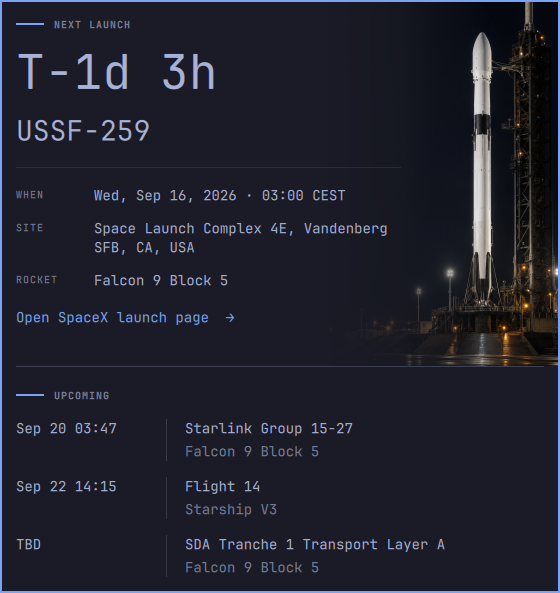

# oma-space-launch

An Omarchy bar-widget plugin that shows a persistent countdown to the next SpaceX launch in the
top bar, with a click-to-open detail panel — following the same pattern as Omarchy's built-in
Clock and Weather widgets.
The panel includes a webcast or launch-page link and the next launch's status when relevant.
See [`PRODUCT.md`](PRODUCT.md) for behavior and [`DESIGN.md`](DESIGN.md) for panel and keyboard details.



## Install

```bash
omarchy plugin add https://github.com/johnviklund/oma-space-launch --enable
```

Or add it without `--enable`, review the code, then run
`omarchy plugin enable oma-space-launch --section center`.

## Remove

```bash
omarchy plugin remove oma-space-launch
rm -rf "${XDG_CACHE_HOME:-$HOME/.cache}/oma-space-launch"   # optional: cached launch data
```

## Dependencies

- `curl` 8.4 or newer and `jq` (preinstalled on Omarchy) — used by `scripts/fetch-launches.sh`.
- Network access to the public [Launch Library 2](https://thespacedevs.com/llapi) API
  (`ll.thespacedevs.com`), polled at most every 15 minutes and cached under
  `${XDG_CACHE_HOME:-~/.cache}/oma-space-launch/`.

Launch responses are limited to 1 MiB before parsing, and each cached text field has a byte limit.
The final cache is limited to 64 KiB. Rejected responses leave the previous cache in place.

## License

[MIT](LICENSE)

## Docs

| Doc | What it's for |
|---|---|
| [`PRODUCT.md`](PRODUCT.md) | What this is, why it exists, and the desired end state |
| [`DESIGN.md`](DESIGN.md) | This plugin's UI additions on top of Omarchy's host styling |
| [`dev/agent-tools/README.md`](dev/agent-tools/README.md) | Optional setup for coding-agent instructions and verification skills |
| [`ROADMAP.md`](ROADMAP.md) | Phased build sequence |
| [`MEMORY.md`](MEMORY.md) | Index of durable patterns learned while building this |
| [`TODO.md`](TODO.md) | Intake scratchpad for not-yet-scoped ideas |
| [`WORKLOG.md`](WORKLOG.md) | Rolling pointer-index of what was built, into git history |

Recent development uses the personal `jflow` skill: `spec` → `build` → `check` → `done`, with
tracked run records under `.jflow/<slug>/`. Earlier `workflow` runs remain under `.workflow/<slug>/`.

## Install and develop

From the repository root, validate and install the plugin as a user-owned development symlink:

```bash
omarchy plugin validate .
ln -sfn "$PWD" ~/.config/omarchy/plugins/oma-space-launch
omarchy-shell shell rescanPlugins
omarchy plugin enable oma-space-launch --section center
```

The bar reloads plugin code from that symlink. Middle-click the pill to force a data refresh.

For isolated verification, use the [verify skill](dev/agent-tools/verify-oma-space-launch/SKILL.md)
and its [feature map](dev/agent-tools/verify-oma-space-launch/features/README.md).
Its `control` CLI runs a separate, invisible shell with stubbed network and browser calls.
`control seed --fixture webcast` loads the webcast fixture; `control seed --status 5` seeds Hold.
The exact, NET, TBD and empty fixtures cover the other panel states.

### Optional coding-agent setup

Plugin installation leaves coding-agent discovery paths empty. All development tooling remains
versioned under [`dev/agent-tools/`](dev/agent-tools/README.md).
Developers who choose to enable repository instructions and skills can run this command before starting their coding agent:

```bash
scripts/setup-agent-tools
```

This creates ignored local `AGENTS.md` and skill pointers for Codex and Claude Code.
It runs no tests or desktop commands. Review the [setup guide](dev/agent-tools/README.md) for details.
